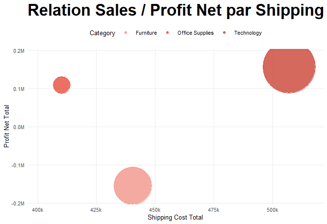

# 📈 Sales Data Cleaning & Analysis in R

Cleaning, merging and feature engineering of two datasets (**Orders** ≈ 51,000 rows and **Returns**) with `dplyr`, `tidyr` and `data.table`, followed by KPIs and **10 ggplot2 charts**, including the Top 10 products.

> **Status:** script refactored for reproducibility. Results below are generated by running the script on the data.

## 🧩 What the script does (`R/analysis.R`)
1. **Import and audit**: dimensions, structure, missing values per column
2. **Cleaning**: drop empty/irrelevant columns, parse dates, validate them (`stopifnot`)
3. **Feature engineering**: order year/month, `ShipDays`, one-hot `Market`, join with Returns (`left_join`), `Profit.Net`, `Margin_Profit`, `Margin_Category`, `OrderScore`, `Exact_location`
4. **KPIs**: sales, units, orders, customers, average shipping cost, net profit, discounted-order ratio
5. **Aggregations**: by category, by segment, return rate, monthly sales, **Top 10 products** (computed with `dplyr` *and* `data.table`, checked equal)
6. **10 charts** saved to `results/figures/`, tables to `results/tables/`

`OrderScore = 0.5 × margin% + 20 / ShipDays − 30 if returned` (ShipDays floored at 1 to avoid division by zero).

## ▶️ Run
```r
install.packages(c("dplyr", "tidyr", "data.table", "ggplot2", "scales"))
```
```bash
Rscript R/analysis.R      # from the project root, with data/Orders.csv and data/Returns.csv
```

## 📊 Results
*Add after running: the KPI table (`results/tables/kpi_table.csv`) and 2-3 key charts.*

<!--  -->
<!--  -->

## 📁 Structure
```
R/analysis.R      full pipeline
data/             input CSV files (see data/README.md)
results/figures/  10 PNG charts
results/tables/   KPI table, aggregations, Top 10
```

## 👤 Author
Marwen Ben Haj Kacem · Master's in Data Science, ISIMA
