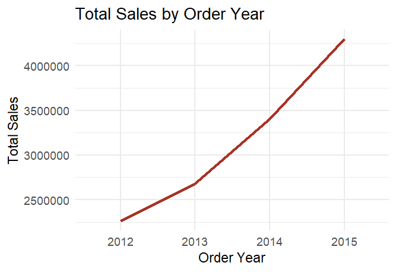
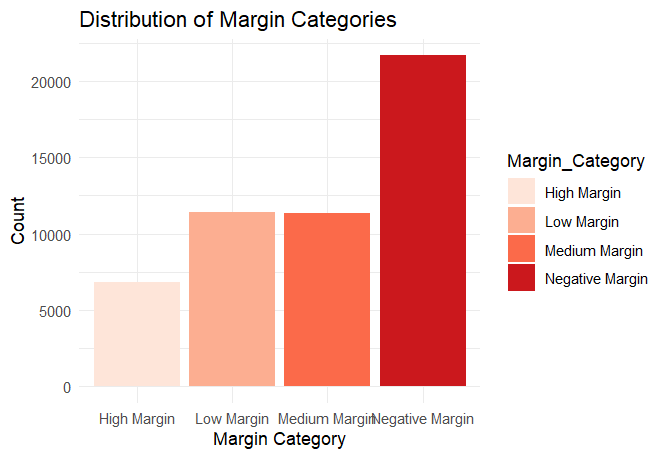
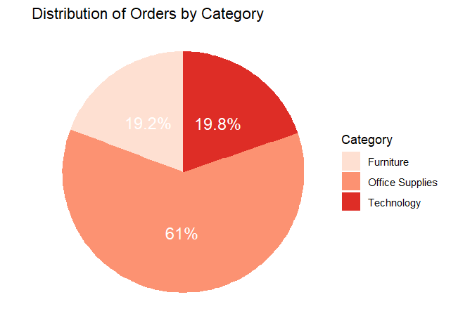
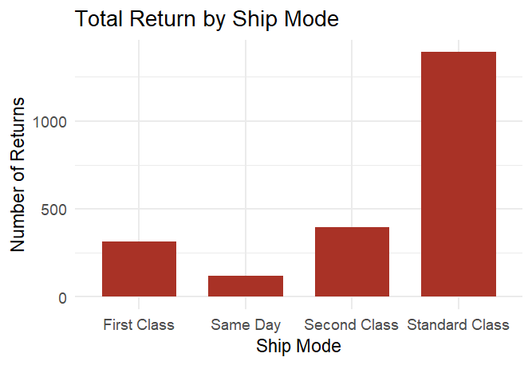

# 📈 Sales Data Cleaning & Analysis in R

Cleaning, merging and feature engineering of two datasets (**Orders** ≈ 51,000 rows and **Returns**) with `dplyr`, `tidyr` and `data.table`, followed by KPIs and **10 ggplot2 charts**, including the Top 10 products.

> **Status:** complete. The first version of the script was run on the data (console output reproduced and re-checked independently); the refactored `R/analysis.R` regenerates every figure and table.

## 🔎 Dataset facts (checked on the files)
| Item | Value |
|---|---|
| Orders | 51,290 rows × 24 columns, 4 years of orders, 5 markets, 3 categories |
| Returns | 1,079 returned orders (`Returned = Yes`) → 2,220 returned order lines (4.3%) |
| Missing values | only `Postal Code` (41,296 rows, 80.5%) → column dropped |
| Join | `Order ID` is unique in Returns, so the join adds no duplicate rows (51,290 rows before and after) |
| Same-day shipping | 2,600 lines have `ShipDays = 0`; a plain `1/ShipDays` would give `Inf` in `OrderScore`, hence the floor at 1 |
| Raw totals (control values) | sales 12,642,501.91 · profit 1,467,457.29 · 796 customers · 178,312 units |

Control totals after the script's own rounding to 2 decimals: `Total_Sales` = 12,642,502.25 and `Total_Profit_Net` = 109,370.62 (the raw, unrounded sales sum is 12,642,501.91).

## 🧩 What the script does (`R/analysis.R`)
1. **Import and audit**: dimensions, structure, missing values per column
2. **Cleaning**: drop empty/irrelevant columns, parse dates, validate them (`stopifnot`)
3. **Feature engineering**: order year/month, `ShipDays`, one-hot `Market`, join with Returns (`left_join`), `Profit.Net`, `Margin_Profit`, `Margin_Category`, `OrderScore`, `Exact_location`
4. **KPIs**: sales, units, orders, customers, average shipping cost, net profit, discounted-order ratio
5. **Aggregations**: by category, by segment, return rate, monthly sales, **Top 10 products** (computed with `dplyr` *and* `data.table`, checked equal)
6. **10 charts** saved to `results/figures/`, tables to `results/tables/`

`OrderScore = 0.5 × margin% + 20 / ShipDays − 30 if returned` (ShipDays floored at 1 to avoid division by zero).

## ▶️ Run
```r
install.packages(c("dplyr", "tidyr", "data.table", "ggplot2", "scales"))
```
```bash
Rscript R/analysis.R      # from the project root, with data/Orders.csv and data/Returns.csv
```

## 📊 Results
| KPI | Value |
|---|---|
| Total sales | 12.64 M |
| Units sold | 178,312 |
| Order lines / customers | 51,290 / 796 |
| Average shipping cost per line | 26.48 |
| Net profit (profit − shipping cost) | 109,371 |
| Discounted lines | 42.5% |



**Findings**
- **Sales almost doubled in 4 years**: 2.26 M (2012) → 2.68 M → 3.41 M → 4.30 M (2015).
- **Shipping cost eats the profit**: raw profit is 1.47 M, but after subtracting shipping cost the net profit is only 109 k. **42.3% of order lines have a negative net margin** (mean margin −7.6%).
- **Furniture loses money** once shipping is included (−155 k net profit), while Technology (+157 k) and Office Supplies (+108 k) are profitable.
- **Returns**: 4.3% of lines. Consumer has the highest return rate (4.56%), then Corporate (4.21%) and Home Office (3.85%). Standard Class concentrates 1,392 of the 2,220 returned lines.
- **Home Office** has the best average net profit per line (3.31 vs 1.86 Consumer and 1.89 Corporate).
- **Top 3 products by sales** are smartphones: Apple Smart Phone Full Size (86.9 k), Cisco (76.4 k), Motorola (73.2 k).

 


## 🐛 Issues found while running the first version (and fixed)
- `OrderScore` was `Inf` for the **2,600 same-day shipments** (`1 / ShipDays` with `ShipDays = 0`): ggplot silently dropped them. Fixed by flooring `ShipDays` at 1.
- The pie chart used an object (`orders_cat`) that was **never created by the script**; it only worked because it was restored from a saved `.RData` workspace. The script is now self-contained (do not commit `.RData`).
- `ts_data` was named `total_sales` but counted orders; it now holds both sales and order counts.

## 📁 Structure
```
R/analysis.R      full pipeline
data/             input CSV files (see data/README.md)
results/figures/  10 PNG charts
results/tables/   KPI table, aggregations, Top 10
```

## 👤 Author
Marwen Ben Haj Kacem · Master's in Data Science, ISIMA
